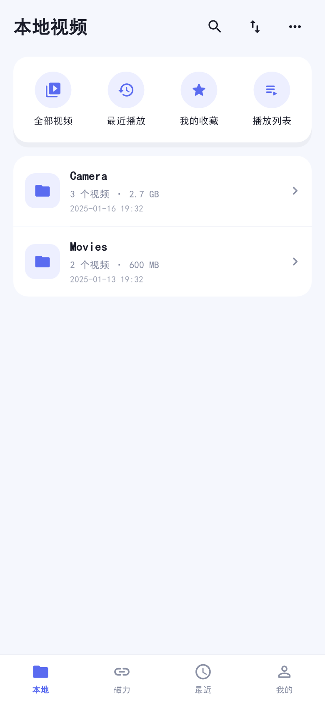
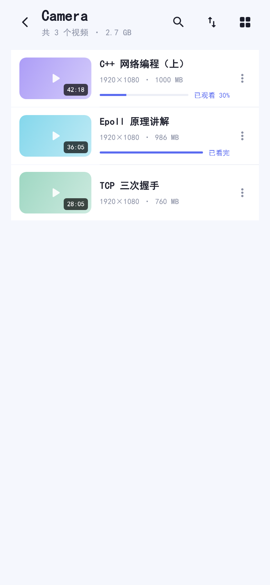
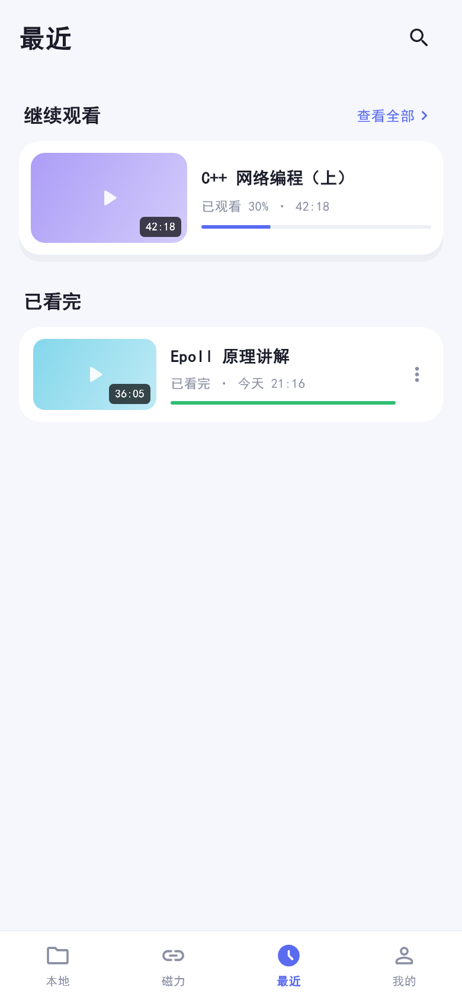
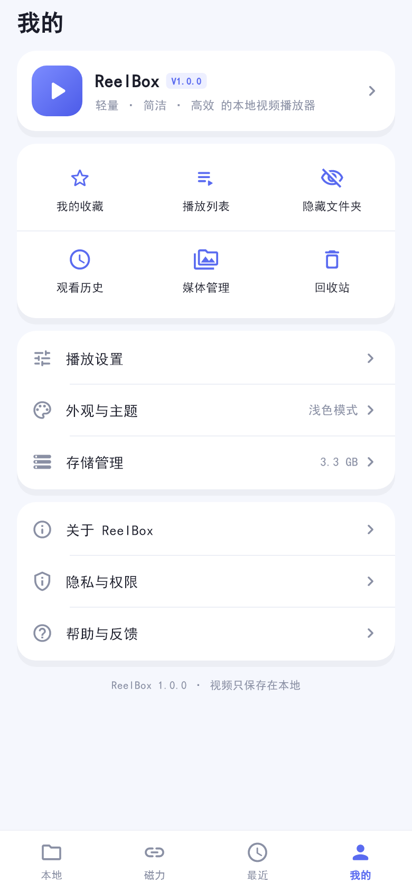
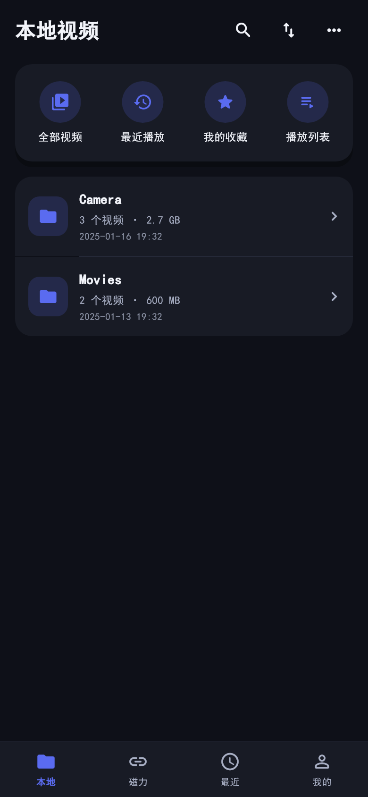

# ReelBox

轻量、简洁、高效的本地视频播放器（Flutter · Android / iOS）。

以本地视频文件夹为核心，以视频播放为基础，以视频管理为辅助：打开应用即可看到手机里的视频文件夹，进入文件夹直接播放，同时提供收藏、自定义分类、播放列表与观看历史。

> 本仓库由 `flutter create` 初始工程改造而来，工程名仍为 `myplayer`，应用名为 **ReelBox**。

## 界面预览

| 本地视频 | 文件夹 | 最近播放 | 我的 |
| --- | --- | --- | --- |
|  |  |  |  |

| 磁力（预告） | 我的分类 | 播放列表 | 深色主题 |
| --- | --- | --- | --- |
|  |  |  |  |

> 预览图由 `test/preview/screens_preview_test.dart` 在测试环境渲染生成（`flutter test test/preview`），
> 使用固定测试媒体库，封面为占位图。

---

## 1. 已实现功能

### 本地视频
- 首次启动权限引导、拒绝授权后的引导与「手动导入」兜底
- 基于 `photo_manager` 扫描系统相册视频，按相册分组建立文件夹列表
- 首页文件夹优先布局：文件夹图标、名称、视频数量、总大小、最近更新时间
- 文件夹视频列表、全部视频、视频搜索（全部 / 当前文件夹，模糊匹配）
- 排序：名称升/降序、添加时间、修改时间、时长、文件大小，选择持久化
- 列表 / 网格切换，选择持久化
- 缩略图异步加载 + 磁盘缓存 + 占位图，视频不可访问时降级显示
- 导入视频：系统文件选择器 → 复制到应用私有目录 → 探测时长 / 分辨率 / 封面，全程显示进度，同名同大小自动去重
- 点击视频只播放当前这一个视频，不会自动把同列表的其他视频排进播放队列
- 长按多选、全选、批量收藏 / 分类 / 播放列表 / 移除
- 多选「更多」菜单：添加至收藏、添加到播放列表、分享（占位）、重命名（多选自动加序号）、删除
- 收藏夹：可新建多个收藏夹，批量收藏时在 40% 高度的面板里选择，收藏页可按收藏夹筛选
- 多选操作栏的收藏图标会跟随状态变化：未收藏是空心星，已全收藏是实心星
- 视频操作菜单：收藏到收藏夹、取消收藏、添加到分类、添加到播放列表、重命名显示名称、详情、分享（复制路径）、从 ReelBox 移除

### 视频管理
- 收藏夹（首页快捷入口、我的页面入口）：默认「我的收藏」，可自定义多个；顶部胶囊切换筛选
- 自定义分类：新建、重命名、删除；一个视频可同时属于多个分类；删除分类不影响视频
- 播放列表：新建、重命名、删除、添加 / 移除视频、拖动排序、播放全部、从指定视频开始播放
- 播放列表播放模式（独立于单个视频）：列表循环 / 单集循环 / 不循环，选择持久化
  - 列表循环：播完自动播放下一个，最后一个播完回到第一个
  - 单集循环：当前视频播完从头重播
  - 不循环：播完自动停止
- 「从 ReelBox 移除」只删应用内记录，不删除原始文件

### 播放器
- `media_kit` 播放引擎，`VideoPlaybackEngine` 接口隔离，UI 不直接依赖插件对象
- 播放 / 暂停 / 进度条拖动 / 上一集下一集 / 播放队列
- 倍速 0.5x ~ 5.0x（0.5 / 0.75 / 1 / 1.5 / 2 / 2.5 / 3 / 3.5 / 4 / 4.5 / 5），支持设置默认倍速与播放时临时调整
- 单视频倍速记忆：每个视频记住自己上次用的倍速，重新打开自动沿用；没有记录时用全局默认倍速
- 全屏与横竖屏切换（播放器内旋转按钮）
- 手势：单击显隐控制栏、双击左右快退/快进 10 秒、双击中间播放暂停、左右滑动调节进度、双指捏合放大画面（最大 4 倍，双指可拖动查看局部）、左侧上下滑动调屏幕亮度、右侧调系统媒体音量、长按进入临时加速并左右滑动调速（0.5x ~ 5x，起点可在播放设置中选 1.5x ~ 5x；滑动时屏幕中下方显示横向速度刻度，当前档位高亮）；手势可在设置中关闭
- 播放模式：单个视频默认「不循环」；播放列表可选「列表循环 / 单集循环 / 不循环」
- 播放器右上角：分享（占位）+ 更多设置（右侧竖条面板，只占屏幕右侧）
  - 播放方式：不循环 / 列表循环 / 单集循环
  - 画面尺寸：常规 / 铺满 / 拉伸 / 原始比例
  - 选项横向排列、无说明文字，选中项主色高亮；点面板左侧画面或右上角 × 关闭
- 倍速面板同样从右侧滑出，竖向排列（5.0x → 0.5x），当前档位高亮，点选即生效
- 点面板左侧画面任意位置即可退出设置、继续看视频
- 控制栏：左侧为「上一集 / 播放暂停 / 下一集」小图标，右侧为倍速与横竖屏，整行垂直居中
- 播放器左侧竖排浮层：截图、锁定画面（随控制栏一起显隐）
- 截图：mpv 原生抓帧（`screenshot-to-file`）保存到系统相册，首次使用提示授权
- 锁定：屏蔽全部手势与控制栏，点屏幕浮现锁图标，点它解锁；返回键也先解锁
- 进度条：左侧显示已播放时间，右侧显示总时长，拖动时左侧实时跟随
- 横竖屏切换按钮位于播放控制栏右下角
- 进度记忆：每 5 秒保存一次，暂停 / 拖动 / 退出 / 进入后台立即保存；< 15 秒从头播放，> 15 秒询问续播，≥ 95% 标记已看完
- 播放失败给出可读提示（文件不存在、权限失效、格式不支持），支持重新加载

### 网络（B 站直播）
- 直播搜索：搜直播间与主播，结果显示名称、标题、房间号与开播状态；支持直接粘贴直播间链接 / 房间号
- 双路观赛：画面来源（赛事画面）+ 声音来源（解说），两路分别取流，只有一路发声
- 声音切换：赛事原声 / 解说声音随时切换；声音源未开播时自动回退赛事原声并提示
- 手动同步：画面慢 0.5 秒 / 声音慢 0.5 秒，按另一路真实播放进度计时；可重新连接从零校准
- 收藏与组合：收藏直播间、保存「画面 + 声音」组合，下次打开自动带出
- 收藏状态刷新：进入页面时并发查询直播间开播状态，显示「直播中 / 未开播」
- 网络视频：视频 tab 可保存 mp4 / m3u8 直链并直接播放（进度、暂停、拖动）
- 线路回退：取流返回多条 CDN 时按 FLV → HLS 顺序自动尝试，失败自动释放旧实例

### 最近播放 / 我的
- 底部导航：本地 / 网络 / 磁力 / 我的
- 最近播放页（入口在「我的」与本地首页快捷入口）：继续观看 + 按「今天 / 昨天 / 更早」分组的播放记录
- 网络：见下方「网络（B 站直播）」
- 播放记录可从视频操作菜单单条清除（只删进度）
- 我的页：应用信息卡、两行三列快捷宫格、播放设置 / 外观与主题 / 存储管理、关于 / 隐私 / 帮助
- 主题：浅色、深色、跟随系统，全局生效并持久化
- 存储管理：视频库索引统计、缓存说明、清空记录、清空索引
- 隐藏文件夹、媒体扫描管理（权限状态、上次扫描时间、重新扫描）
- 磁力：仅入口与「功能开发中」预告，不执行任何磁力任务

### 工程质量
- 75 个单元 / Widget 测试全部通过，`flutter analyze` 零问题
- 本地数据带 schema 版本与迁移函数（v1 收藏数组 → v2 `media.isFavorite`；旧收藏会自动归入「我的收藏」）
- GitHub Actions：格式化检查、静态检查、测试、Debug APK 构建

---

## 2. 技术栈

| 领域 | 方案 |
| --- | --- |
| UI | Flutter 3.35+ / Material 3 |
| 状态管理 | Riverpod 3（`Notifier` / `NotifierProvider`） |
| 路由 | go_router 18 |
| 播放 | media_kit + media_kit_video |
| 媒体库 | photo_manager |
| 文件导入 | file_picker |
| 本地存储 | 版本化 JSON 文档库（`LocalDatabase`，可替换 Drift/SQLite） |
| 屏幕常亮 | wakelock_plus |
| 屏幕亮度 | screen_brightness（仅调整当前窗口） |
| 系统音量 | volume_controller |

---

## 3. 目录结构

```
lib/
├── app/                     # 启动、Provider、路由、根组件
│   ├── app.dart
│   ├── bootstrap.dart
│   ├── providers.dart
│   └── router.dart
├── core/
│   ├── database/            # 本地文档数据库 + 结构迁移
│   ├── theme/               # 设计令牌、浅色 / 深色主题
│   ├── utils/               # 时长、大小、时间格式化
│   └── widgets/             # 通用组件、弹窗
├── features/
│   ├── library/             # 视频库：模型、仓储、扫描、导入、列表页
│   ├── category/            # 自定义分类
│   ├── playlist/            # 播放列表
│   ├── favorites/           # 收藏
│   ├── history/             # 最近播放（今天 / 昨天 / 更早）
│   ├── player/              # 播放引擎、队列、会话、播放器页面
│   ├── magnet/              # 磁力预告页
│   ├── network/             # B 站直播搜索 / 双路播放 / 收藏 / 网络视频
│   ├── settings/            # 设置、主题、存储、媒体管理、关于
│   ├── profile/             # 我的页面
│   └── shell/               # 底部导航外壳
└── main.dart
```

分层：`Presentation → Application（Notifier）→ Data（Repository / 适配器）→ Domain（模型与规则）`。
详见 [`docs/ARCHITECTURE.md`](docs/ARCHITECTURE.md)。

---

## 4. 运行

```bash
flutter pub get
flutter run                  # 连接 Android / iOS 设备
```

真机首次启动会申请视频读取权限；拒绝后仍可通过首页「导入视频」选择文件。
应用把导入副本复制到应用私有目录，相册视频只保存索引，不复制文件。

构建：

```bash
flutter build apk --debug       # Android，产物 build/app/outputs/flutter-apk/app-debug.apk
flutter build ios --no-codesign # iOS（需要 macOS / Xcode）
```

> 首次 Android 构建需要从 GitHub 下载 media_kit 的 libmpv 原生库（4 个 ABI），网络较慢时约需 30 分钟；之后的增量构建在 1 分钟内。

测试：

```bash
flutter analyze
flutter test                              # 单元 + Widget 测试
flutter test test/preview                 # 生成 docs/preview 界面预览图
flutter test integration_test -d <设备>    # 端到端流程（需真机 / 模拟器）
dart format lib test integration_test
```

> 本机验证环境：Flutter 3.50.0-0.4.pre（master）。`pubspec.yaml` 的 SDK 约束为 `^3.9.0` 且要求 Flutter ≥ 3.35，便于在 stable 通道构建。

---

## 5. 与原始技术方案的差异

| 方案要求 | 当前实现 | 原因 |
| --- | --- | --- |
| Drift + SQLite | `LocalDatabase`：单文件 JSON + `schemaVersion` + 迁移函数，Repository 隔离 | 避免在本机引入 build_runner 代码生成链路；元数据量级足够，接口可无缝替换 Drift |
| Freezed / json_serializable | 手写不可变模型 + `copyWith` / `toJson` / `fromJson` | 减少生成依赖，保证离线可构建 |
| 字幕、音轨切换（P1） | 暂未提供 UI 入口 | V1.0 验收标准未包含；`media_kit` 已具备轨道能力，可作为 V1.5 增强 |
| 分享视频 | 复制视频路径到剪贴板 | 未引入 `share_plus`，避免额外平台配置 |
| 亮度 / 音量调节 | 窗口亮度用 `screen_brightness`，音量用 `volume_controller` 调系统媒体音量 | 手势真实生效；亮度只在播放器窗口内修改，退出后恢复系统亮度 |
| 缩略图生成 | 相册资源由 `photo_manager` 生成并缓存；导入文件可用 `MediaProbe` 截图 | 保证列表懒加载，避免批量解码 |

已知限制：

- iOS 构建需在 macOS 上验证（本机为 Windows，无法编译 iOS）。
- 媒体格式、硬件解码、横竖屏与后台行为需在 Android / iOS 真机复核。
- 缩略图缓存位于应用缓存目录，清理缓存只删除缩略图，不影响原始视频。
- 播放器手势、亮度与音量需真机验证。

---

## 6. 验收对照

| 验收项 | 状态 |
| --- | --- |
| Android / iOS 授权范围内获取视频 | ✅ 代码完成（需真机验证） |
| 显示文件夹 / 相册分组 | ✅ |
| 进入文件夹查看视频 | ✅ |
| 缩略图与基本信息 | ✅ |
| 搜索与排序 | ✅ |
| 网格 / 列表切换 | ✅ |
| 创建 / 重命名 / 删除分类 | ✅ |
| 视频加入分类、多分类归属、删除分类不影响视频 | ✅ 单测覆盖 |
| 点击视频直接播放 | ✅ |
| 播放、暂停、进度拖动 | ✅ |
| 倍速 | ✅ |
| 全屏与横竖屏切换 | ✅ |
| 播放进度记忆 | ✅ 单测覆盖 |
| 播放列表连续播放 | ✅ 队列单测覆盖 |
| 播放异常提示 | ✅ |
| 收藏、播放列表、最近播放、继续观看 | ✅ |
| 浅色 / 深色 / 跟随系统 | ✅ Widget 测试覆盖 |
| 我的页面 | ✅ |
| 磁力入口仅预告 | ✅ |
| 网络直播搜索 / 双路播放 / 同步 | ✅ 接口已联调（搜索 / 详情 / 取流） |
| 编译 Android / iOS | Android ✅ 本机已构建 `app-debug.apk`（207 MB，含 3 个 ABI 与 mpv 库）；iOS 需 macOS 验证 |
| 核心业务单测 | ✅ 75 个测试 |
| 数据库版本迁移 | ✅ 单测覆盖 |
| 播放器无明显资源泄漏 | ✅ 会话统一释放引擎 / 订阅 / 定时器 |
| GitHub Actions 基础检查 | ✅ `.github/workflows/flutter-ci.yml` |

---

## 7. 隐私

- 无账号、无自有后端；本地视频库不发起任何网络请求。
- 网络模块只在用户主动搜索直播间、添加链接或播放直播 / 网络视频时访问 B 站公开接口，不会后台自动联网。
- 不上传、不备份、不分析视频内容；索引、分类、收藏与组合只保存在本机。
- 只申请视频读取权限与网络访问权限；不申请通讯录、位置、麦克风等无关权限。
