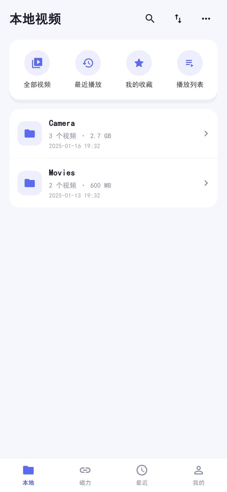
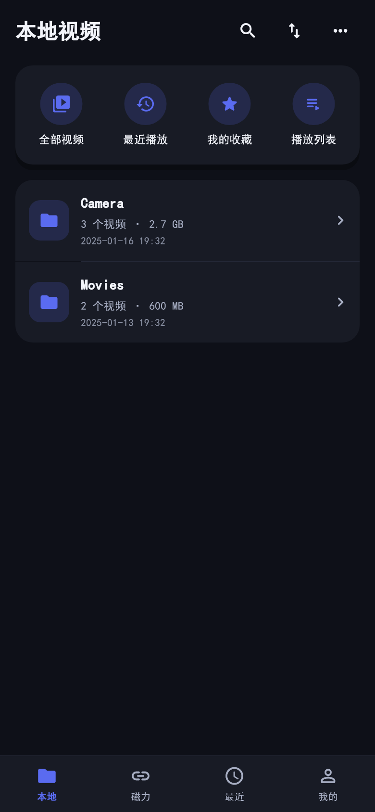

# LumiPlayer

基于 Flutter 的视频播放器，支持本地视频管理、网络视频、B 站双路直播和局域网文件传输，目前主要面向 Android。

## 主要功能

- **本地视频**：扫描视频文件夹、手动导入、搜索与排序。
- **播放控制**：倍速、横竖屏切换、手势调节亮度与音量、截图和画面锁定。
- **内嵌字幕与音轨**：读取视频自带字幕和多条音轨，支持自动、关闭及手动切换；ASS 以纯文本显示，图片型字幕暂不支持。
- **视频管理**：收藏、分类、播放列表、观看记录和断点续播。
- **B 站直播**：搜索与收藏直播间、关联 B 站账号、切换画质和显示弹幕。
- **双路观赛**：分别选择画面与声音来源，切换原声或解说，手动调整同步。
- **局域网传输**：接收端亮码、发送端扫码配对，TLS 加密传输并逐文件校验。
- **网络视频与主题**：播放 MP4 / M3U8 直链，支持浅色、深色和跟随系统。

## 界面预览

| 本地视频 | 播放列表 | 深色主题 |
| --- | --- | --- |
|  |  |  |

## 运行与构建

安装 Flutter，确保其 Dart 版本满足 [pubspec.yaml](pubspec.yaml) 中的要求，然后在项目目录运行：

```bash
flutter pub get
flutter run
```

构建 Android 安装包（按 ABI 拆分，避免把三套原生库打进同一个 APK）：

```bash
flutter build apk --release --split-per-abi
```

arm64 手机会生成 `build/app/outputs/flutter-apk/app-arm64-v8a-release.apk`。

## 技术栈

Flutter · Riverpod · go_router · media_kit · mobile_scanner

更多开发说明见 [项目结构](docs/PROJECT_STRUCTURE.md) 和 [架构文档](docs/ARCHITECTURE.md)。
